# Molecular Workbench

A comprehensive computational chemistry suite for exploring molecular structures, quantum orbitals, transition states, reaction paths (IRC), and generating lightweight, zero-backend 3D visualizations (`.rxnbundle.zip`).

---

## Prerequisites

- **Python**: Version **3.9 to 3.12** is required (to ensure compatibility with PySCF, tblite, and ASE).
- **ORCA** (Optional): Version 5.x / 6.x if using ORCA-driven transition state and IRC calculations.

---

## Installation

This repository respects your preferred Python environment (e.g. `venv`, `conda`).

1. **Clone the repository**:
   ```bash
   git clone git@github.com:fbeilstein/molecular_workbench.git
   cd molecular_workbench
   ```

2. **Create and activate your environment**:
   ```bash
   python3 -m venv .venv
   source .venv/bin/activate
   ```

3. **Install Dependencies & Tooling**:
   ```bash
   pip install -r requirements.txt
   bash setup.sh --with-ml
   ```
   *This installs RDKit, ASE, Sella, PySCF, tblite (xTB) and downloads the required `xtb` engine binary into the `tools/` folder.*

---

## Running the Workbenches

The repository provides three dedicated workbenches and a zero-backend standalone viewer:

### 1. Single-Molecule Quantum Workbench
Compute 3D geometries, Intrinsic Bond Orbitals (IBO), and Electrostatic Potential (ESP) maps for individual molecules:
```bash
python server.py --port 4321
```
Open [**http://localhost:4321**](http://localhost:4321) in your browser.


### 2. Transition State & IRC Workbench
Find reaction transition states, analyze vibrational normal modes, integrate full IRC reaction pathways, calculate orbitals, and prepare bundle:
```bash
python server_irc.py --port 8082
```
Open [**http://localhost:8082**](http://localhost:8082) in your browser.


### 3. Standalone 3D Web Viewer (`viewer.html`)
A standalone client-side viewer that unpacks `.rxnbundle.zip` archives directly in the browser's memory using `JSZip` and renders them with `3Dmol.js`:
- Open `viewer.html` directly or serve via GitHub Pages.
- Drag & drop any `.zip` bundle, or pass it via URL query parameter: `viewer.html?bundle=<path-or-url>`.

---

## Documentation

- [Transition State Engines & Search Strategies](docs/ts_engines.md): Details on Genetic Swarm, Dual-Endpoint IDPP, and Sella DLC optimization.
- [Machine Learning TS Models (RitS & TS-Diff)](docs/ml_models.md): Setup instructions and weight checkpoint downloads for generative flow-matching TS models.
- [Architecture Overview](docs/architecture.md): High-level system structure, components, and data pipelines.
- [Scientific Choices & Quantum Methodology](docs/scientific_choices.md): Level of theory, Intrinsic Bond Orbitals (IBO), and exact virtual subspace antisymmetrization.
- [Agent Knowledge & Technical Gotchas](docs/agent_knowledge.md): Developer notes, PySCF symmetry gotchas, and bundle structures.

---

## Gallery

<details>
<summary><strong>Reactions</strong></summary>

|Reaction|Bundle|
|---|---|
|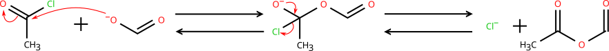|[View Reaction](https://fbeilstein.github.io/molecular_workbench/viewer.html?bundle=bundles/reactions/tetrahedral_intermediate_CO.zip&download)

</details>

<details>
<summary><strong>Molecules</strong></summary>
   
|Molecule|Name|Bundle|Notes|
|--|--|--|--|
||**cyclooctadecanonaene** or **[18]annulene**|[View Molecule](https://fbeilstein.github.io/molecular_workbench/viewer.html?bundle=bundles/molecules/%5B18%5Dannulene.zip&download)|Aromatic: $4n+2$ electrons + planar. <br>SMILES (NOT WORKING IN Ketcher!): C1([H])C([H])=C([H])C([H])=C([H])C([H])=C([H])C([H])=C([H])C([H])=C([H])C([H])=C([H])C([H])=C([H])C([H])=C([H])C=1[H] |c:7,11,19,23,31,34,t:3,15,27||
||**cyclodecapentaene** or **[10]annulene**, or **all-cis-[10]annulene**|[View Molecule](https://fbeilstein.github.io/molecular_workbench/viewer.html?bundle=bundles/molecules/all-cis-%5B10%5Dannulene.zip&download)|NOT Aromatic: $4n+2$ electrons BUT non-planar. <br>SMILES: C1C=CC=CC=CC=CC=1 |c:1,3,5,7,9||
|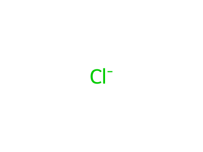|**chloride** or **chloride ion** |[View Molecule](https://fbeilstein.github.io/molecular_workbench/viewer.html?bundle=bundles/molecules/chloride.zip&download)|Charge: -1. <br>SMILES: [Cl-] |
|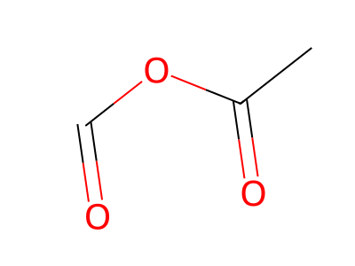|**ethanoic methanoic anhydride** |[View Molecule](https://fbeilstein.github.io/molecular_workbench/viewer.html?bundle=bundles/molecules/ethanoic_methanoic_anhydride.zip&download)|SMILES: CC(OC=O)=O |
|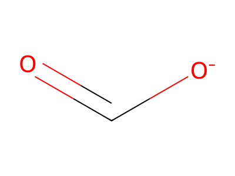|**methanoate** or **formate** |[View Molecule](https://fbeilstein.github.io/molecular_workbench/viewer.html?bundle=bundles/molecules/methanoate.zip&download)|Charge: -1. <br>SMILES: C(=O)[O-] |
|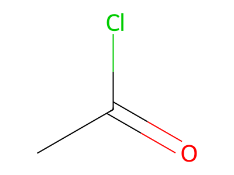|**acetyl chloride** |[View Molecule](https://fbeilstein.github.io/molecular_workbench/viewer.html?bundle=bundles/molecules/acetyl_chloride.zip&download)|SMILES: CC(=O)Cl |
|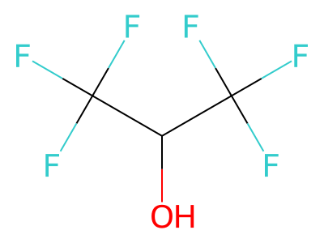|**1,1,1,3,3,3-hexafluoropropan-2-ol**, or **1,1,1,3,3,3-hexafluoro-2-propanol**, or **hexafluoroisopropanol**|[View Molecule](https://fbeilstein.github.io/molecular_workbench/viewer.html?bundle=bundles/molecules/1,1,1,3,3,3-hexafluoropropan-2-ol.zip&download)|$pK_a = 9.3$ <br>SMILES: OC(C(F)(F)F)C(F)(F)F|
|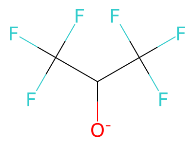|**1,1,1,3,3,3-hexafluoropropan-2-olate** or **hexafluoroisopropoxide**|[View Molecule](https://fbeilstein.github.io/molecular_workbench/viewer.html?bundle=bundles/molecules/1,1,1,3,3,3-hexafluoropropan-2-olate.zip&download)|Charge: -1 <br>SMILES: [O-]C(C(F)(F)F)C(F)(F)F|
|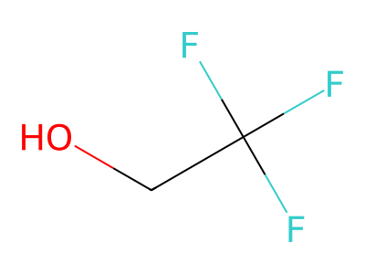|**2,2,2-trifluoroethanol**, or **trifluoroethyl alcohol**, or **TFE**|[View Molecule](https://fbeilstein.github.io/molecular_workbench/viewer.html?bundle=bundles/molecules/2,2,2-trifluoroethanol.zip&download)|$pK_a = 12.4$ <br>SMILES: FC(CO)(F)F|
|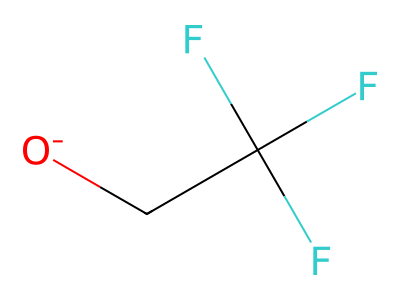|**2,2,2-trifluoroethoxide** or **trifluoroethoxide**|[View Molecule](https://fbeilstein.github.io/molecular_workbench/viewer.html?bundle=bundles/molecules/2,2,2-trifluoroethoxide.zip&download)|Charge: -1 <br>SMILES: FC(C[O-])(F)F|
|propan-2-ol.svg)|**1,1,1,3,3,3-hexafluoro-2-(trifluoromethyl)propan-2-ol**, or **perfluoro-tert-butanol**, or **PFtB**, or **nonafluoro-tert-butyl alcohol**|[View Molecule](https://fbeilstein.github.io/molecular_workbench/viewer.html?bundle=bundles/molecules/1,1,1,3,3,3-hexafluoro-2-(trifluoromethyl)propan-2-ol.zip&download)|$pK_a = 5.4$ <br>SMILES: OC(C(F)(F)F)(C(F)(F)F)C(F)(F)F|
|propan-2-olate.svg)|**1,1,1,3,3,3-hexafluoro-2-(trifluoromethyl)propan-2-olate**, or **perfluoro-tert-butoxide**, or **nonafluoro-tert-butoxide**|[View Molecule](https://fbeilstein.github.io/molecular_workbench/viewer.html?bundle=bundles/molecules/1,1,1,3,3,3-hexafluoro-2-(trifluoromethyl)propan-2-olate.zip&download)|Charge: -1 <br>SMILES: [O-]C(C(F)(F)F)(C(F)(F)F)C(F)(F)F|
|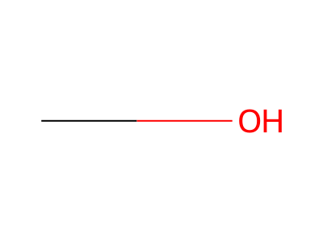|**methanol**, or **methyl alcohol**, or **wood alcohol**, or **carbinol**, or **hydroxymethane**, or **wood spirit**|[View Molecule](https://fbeilstein.github.io/molecular_workbench/viewer.html?bundle=bundles/molecules/methanol.zip&download)|$pK_a = 15.5$ <br>SMILES: CO|
|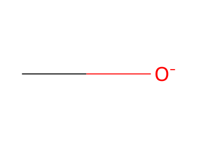|**methanolate**, or **methoxide**, or **methylate**|[View Molecule](https://fbeilstein.github.io/molecular_workbench/viewer.html?bundle=bundles/molecules/methanolate.zip&download)|Charge: -1 <br>SMILES: C[O-]|
|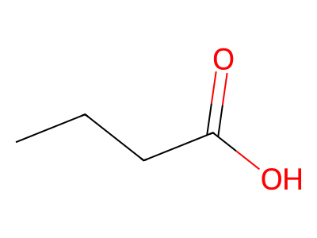|**butanoic acid** or **butyric acid**|[View Molecule](https://fbeilstein.github.io/molecular_workbench/viewer.html?bundle=bundles/molecules/butanoic_acid.zip&download)|$pK_a = 4.8$ <br>SMILES: CCCC(O)=O|
|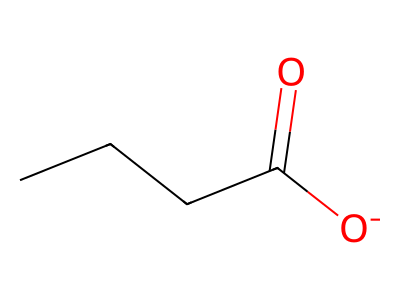|**butanoate** or **butyrate**|[View Molecule](https://fbeilstein.github.io/molecular_workbench/viewer.html?bundle=bundles/molecules/butanoate.zip&download)|Charge: -1 <br>SMILES: CCCC([O-])=O|
|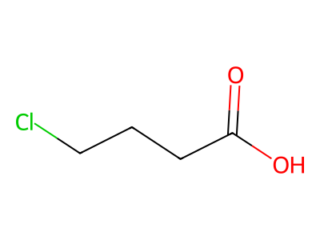|**4-chlorobutanoic acid**, or **$\gamma$-chlorobutyric acid**, or **4-chlorobutyric acid**|[View Molecule](https://fbeilstein.github.io/molecular_workbench/viewer.html?bundle=bundles/molecules/4-chlorobutanoic_acid.zip&download)|$pK_a = 4.5$ <br>SMILES: ClCCCC(O)=O|
|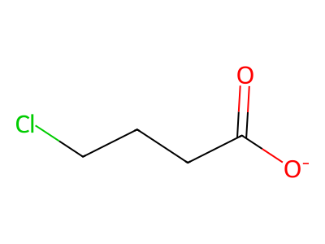|**4-chlorobutanoate**, or **$\gamma$-chlorobutyrate**, or **4-chlorobutyrate**|[View Molecule](https://fbeilstein.github.io/molecular_workbench/viewer.html?bundle=bundles/molecules/4-chlorobutanoate.zip&download)|Charge: -1 <br>SMILES: ClCCCC([O-])=O|
|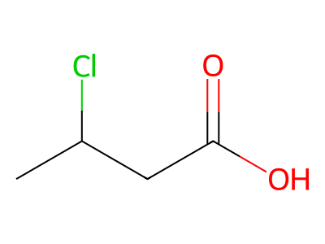|**3-chlorobutanoic acid**, or **$\beta$-chlorobutyric acid**, or **3-chlorobutyric acid**|[View Molecule](https://fbeilstein.github.io/molecular_workbench/viewer.html?bundle=bundles/molecules/3-chlorobutanoic_acid.zip&download)|$pK_a = 4.1$ <br>SMILES: CC(CC(O)=O)Cl|
|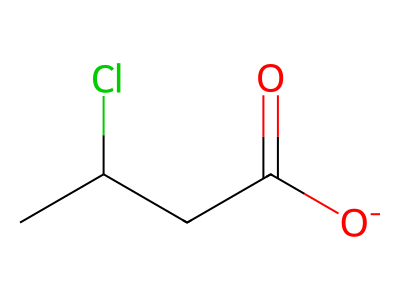|**3-chlorobutanoate**, or **$\beta$-chlorobutyrate**, or **3-chlorobutyrate**|[View Molecule](https://fbeilstein.github.io/molecular_workbench/viewer.html?bundle=bundles/molecules/3-chlorobutanoate.zip&download)|Charge: -1 <br>SMILES: CC(CC([O-])=O)Cl|
|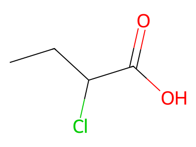|**2-chlorobutanoic acid**, or **$\alpha$-chlorobutyric acid**, or **2-chlorobutyric acid**|[View Molecule](https://fbeilstein.github.io/molecular_workbench/viewer.html?bundle=bundles/molecules/2-chlorobutanoic_acid.zip&download)|$pK_a = 2.8$ <br>SMILES: CCC(C(O)=O)Cl|
|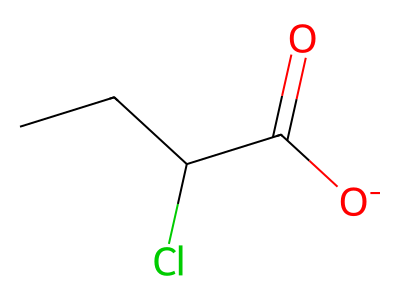|**2-chlorobutanoate**, or **$\alpha$-chlorobutyrate**, or **2-chlorobutyrate**|[View Molecule](https://fbeilstein.github.io/molecular_workbench/viewer.html?bundle=bundles/molecules/2-chlorobutanoate.zip&download)|Charge: -1 <br>SMILES: CCC(C([O-])=O)Cl|
||**ethane**, or **bimethyl**, or **dimethyl**, or **methylmethane**|[View Molecule](https://fbeilstein.github.io/molecular_workbench/viewer.html?bundle=bundles/molecules/ethane.zip&download)|SMILES: CC|
||**ethene** or **ethylene**, or **olefiant gas**, or **elayl**, or **bicarburetted hydrogen**|[View Molecule](https://fbeilstein.github.io/molecular_workbench/viewer.html?bundle=bundles/molecules/ethene.zip&download)|SMILES: C=C|
||**ethyne** or **acetylene**, or **narcylen**|[View Molecule](https://fbeilstein.github.io/molecular_workbench/viewer.html?bundle=bundles/molecules/ethyne.zip&download)|SMILES: C#C|
||**benzene**, or **cyclohexa-1,3,5-triene**, or **benzol**, or **[6]annulene**, or **phene**, or **bicarburet of hydrogen**|[View Molecule](https://fbeilstein.github.io/molecular_workbench/viewer.html?bundle=bundles/molecules/benzene.zip&download)|Simplest aromatic molecule <br>SMILES: C1C=CC=CC=1|
|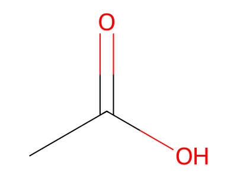|**ethanoic acid** or **acetic acid**|[View Molecule](https://fbeilstein.github.io/molecular_workbench/viewer.html?bundle=bundles/molecules/ethanoic_acid.zip&download)|$pK_a = 4.76$ <br>SMILES: CC(=O)O|
|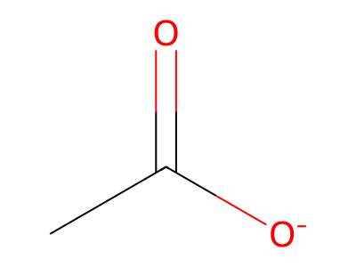|**ethanoate** or **acetate**|[View Molecule](https://fbeilstein.github.io/molecular_workbench/viewer.html?bundle=bundles/molecules/ethanoate.zip&download)|Charge: -1 <br>SMILES: CC(=O)[O-]|
|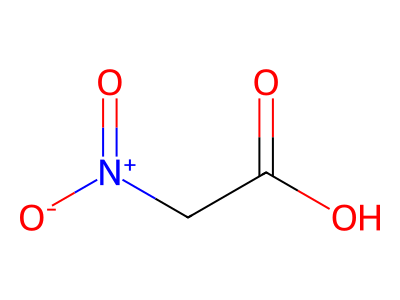|**nitroethanoic acid** or **nitroacetic acid**|[View Molecule](https://fbeilstein.github.io/molecular_workbench/viewer.html?bundle=bundles/molecules/nitroethanoic_acid.zip&download)|$pK_a = 1.7$ <br>SMILES: O=C(C[N+](=O)[O-])O|
|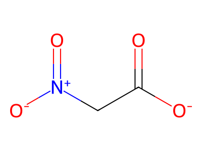|**nitroethanoate** or **nitroacetate**|[View Molecule](https://fbeilstein.github.io/molecular_workbench/viewer.html?bundle=bundles/molecules/nitroethanoate.zip&download)|Charge: -1 <br>SMILES: O=C(C[N+](=O)[O-])[O-]|
|trimethylazanium.svg)|**(carboxymethyl)trimethylazanium**, or **(trimethylazaniumyl)ethanoic acid**, or **betainium**, or **protonated betaine**, or **$N,N,N$-trimethylglycine** (acid form), or **carboxymethyltrimethylammonium**|[View Molecule](https://fbeilstein.github.io/molecular_workbench/viewer.html?bundle=bundles/molecules/(carboxymethyl)trimethylazanium.zip&download)|$pK_a = 1.8$, Charge: +1 <br>SMILES: C[N+](CC(O)=O)(C)C|
|ethanoate.svg)|**2-(trimethylazaniumyl)ethanoate**, or **(carboxylatomethyl)trimethylazanium**, or **betaine**, or **$N,N,N$-trimethylglycine** (inner salt)|[View Molecule](https://fbeilstein.github.io/molecular_workbench/viewer.html?bundle=bundles/molecules/2-(trimethylazaniumyl)ethanoate.zip&download)|Charge: 0 <br>SMILES: C[N+](CC([O-])=O)(C)C|
|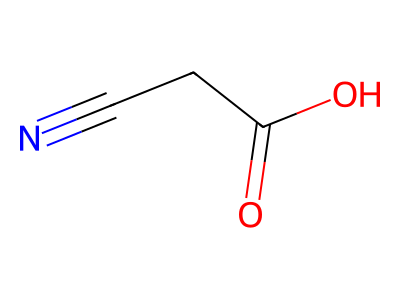|**2-cyanoethanoic acid**, or **cyanacetic acid**|[View Molecule](https://fbeilstein.github.io/molecular_workbench/viewer.html?bundle=bundles/molecules/2-cyanoethanoic_acid.zip&download)|$pK_a = 2.4$ <br>SMILES: N#CCC(O)=O|
|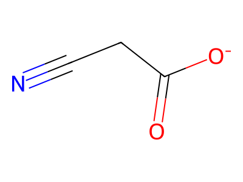|**2-cyanoethanoate**, or **cyanacetate**|[View Molecule](https://fbeilstein.github.io/molecular_workbench/viewer.html?bundle=bundles/molecules/2-cyanoethanoate.zip&download)|Charge: -1 <br>SMILES: N#CCC([O-])=O|
|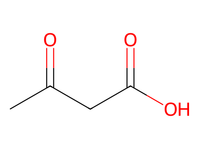|**3-oxobutanoic acid** or **acetoacetic acid**|[View Molecule](https://fbeilstein.github.io/molecular_workbench/viewer.html?bundle=bundles/molecules/3-oxobutanoic_acid.zip&download)|$pK_a = 3.6$ <br>SMILES: CC(CC(O)=O)=O|
|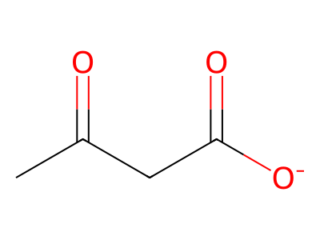|**3-oxobutanoate**, or **acetoacetate**|[View Molecule](https://fbeilstein.github.io/molecular_workbench/viewer.html?bundle=bundles/molecules/3-oxobutanoate.zip&download)|Charge: -1 <br>SMILES: CC(CC([O-])=O)=O|
|-dione.svg)|**1H-isoindole-1,3(2H)-dione**, or **phthalimide**, or **isoindole-1,3-dione**, or **1,3-dihydro-1,3-dioxoisoindole**, or **benzene-1,2-dicarboximide**, or **o-phthalimide**|[View Molecule](https://fbeilstein.github.io/molecular_workbench/viewer.html?bundle=bundles/molecules/1H-isoindole-1,3(2H)-dione.zip&download)|$pK_a = 8.3$ <br>SMILES: O=C1NC(=O)c2ccccc12|
|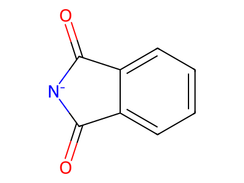|**1,3-dioxo-1,3-dihydro-2H-isoindol-2-ide**, or **phthalimide anion**, or **phthalimidate**, or **1,3-dioxoisoindolin-2-ide**, or **1,3-dioxo-1,3-dihydroisoindol-2-ide**|[View Molecule](https://fbeilstein.github.io/molecular_workbench/viewer.html?bundle=bundles/molecules/1,3-dioxo-1,3-dihydro-2H-isoindol-2-ide.zip&download)|Charge: -1 <br>SMILES: O=C1[N-]C(=O)c2ccccc12|
|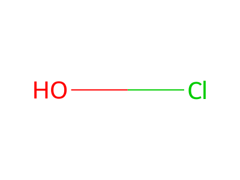|**hypochlorous acid**, or **chloric(I) acid**, or **hydroxidochlorine**|[View Molecule](https://fbeilstein.github.io/molecular_workbench/viewer.html?bundle=bundles/molecules/hypochlorous_acid.zip&download)|$pK_a = 7.5$<br>SMILES: ClO|
|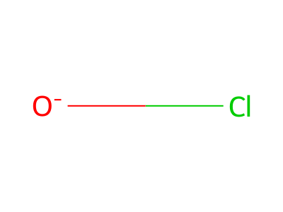|**hypochlorite**, or **chlorate(I)**|[View Molecule](https://fbeilstein.github.io/molecular_workbench/viewer.html?bundle=bundles/molecules/hypochlorite.zip&download)|Charge: -1 <br>SMILES: Cl[O-]|
|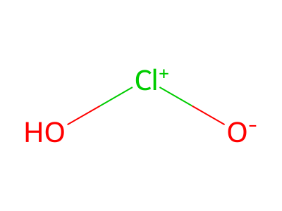|**chlorous acid**, or **chloric(III) acid**, or **hydroxidooxidochlorine**|[View Molecule](https://fbeilstein.github.io/molecular_workbench/viewer.html?bundle=bundles/molecules/chlorous_acid.zip&download)|$pK_a = 2$ <br>SMILES: Cl(=O)O|
|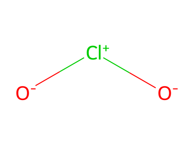|**chlorite**, or **chlorate(III)**|[View Molecule](https://fbeilstein.github.io/molecular_workbench/viewer.html?bundle=bundles/molecules/chlorite.zip&download)|Charge: -1 <br>SMILES: Cl(=O)[O-]|
|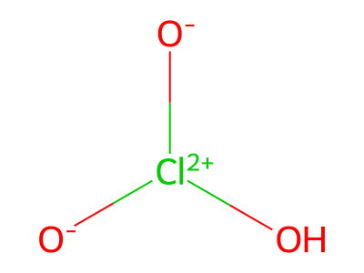|**chloric acid**, or **chloric(V) acid**, or **hydroxidodioxidochlorine**|[View Molecule](https://fbeilstein.github.io/molecular_workbench/viewer.html?bundle=bundles/molecules/chloric_acid.zip&download)|$pK_a = -1$ <br>SMILES: Cl(=O)(O)=O|
|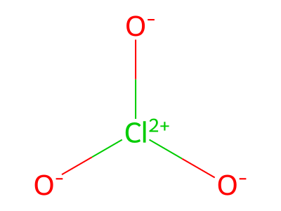|**chlorate**, or **chlorate(V)**|[View Molecule](https://fbeilstein.github.io/molecular_workbench/viewer.html?bundle=bundles/molecules/chlorate.zip&download)|Charge: -1 <br>SMILES: Cl(=O)([O-])=O|
|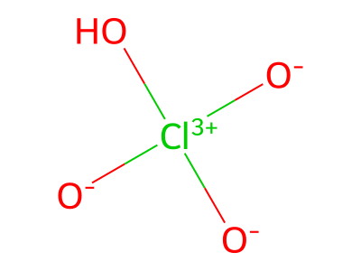|**perchloric acid**, **chloric(VII) acid**, or **hydroxidotrioxidochlorine**|[View Molecule](https://fbeilstein.github.io/molecular_workbench/viewer.html?bundle=bundles/molecules/perchloric_acid.zip&download)|$pK_a \approx -10$ <br>SMILES: Cl(=O)(O)(=O)=O|
|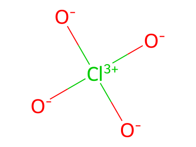|**perchlorate**, or **chlorate(VII)**|[View Molecule](https://fbeilstein.github.io/molecular_workbench/viewer.html?bundle=bundles/molecules/perchlorate.zip&download)|Charge: -1 <br>SMILES: Cl(=O)([O-])(=O)=O|
||**methane**|[View Molecule](https://fbeilstein.github.io/molecular_workbench/viewer.html?bundle=bundles/molecules/methane.zip&download)|$pK_a \approx 48$ <br>SMILES: C|
||**buta-1,3-diene**, or **1,3-butadiene**, or **divinyl**, or **biethylene**, or **vinylethylene**, or **erythrene**, or **pyrrolylene**|[View Molecule](https://fbeilstein.github.io/molecular_workbench/viewer.html?bundle=bundles/molecules/buta-1,3-diene.zip&download)|Simplest non-cyclic delocalized $\pi$ system <br>SMILES: C=CC=C|
|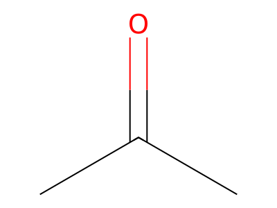|**propan-2-one**, or **acetone**, or **2-propanone**, or **dimethyl ketone**, or **$\beta$-ketopropane**, or **pyroacetic ether**|[View Molecule](https://fbeilstein.github.io/molecular_workbench/viewer.html?bundle=bundles/molecules/propan-2-one.zip&download)|Simplest ketone <br>SMILES: C(C)(C)=O|
||**2-methylpropan-2-ide**, or **tert-butyl carbanion**, or **tert-butyl anion**, or **1,1-dimethylethan-1-ide**, or **trimethylmethanide**|[View Molecule](https://fbeilstein.github.io/molecular_workbench/viewer.html?bundle=bundles/molecules/2-methylpropan-2-ide.zip&download)|Charge: -1 <br>SMILES: [C-](C)(C)C|
||**2-methylpropan-2-ylium**, or **tert-butyl cation**, or **t-butyl cation**, or **trimethylcarbenium**, or **1,1-dimethylethyl cation**|[View Molecule](https://fbeilstein.github.io/molecular_workbench/viewer.html?bundle=bundles/molecules/2-methylpropan-2-ylium.zip&download)|Charge: +1 <br>SMILES: [C+](C)(C)C|
|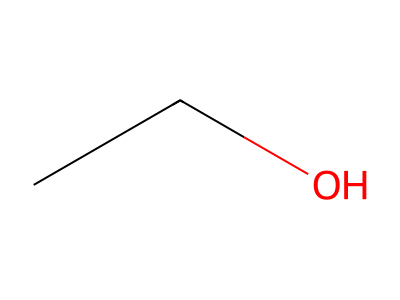|**ethanol**, or **ethyl alcohol**, or **hydroxyethane**, or **drinking alcohol**, or **grain alcohol**, or **spirits of wine**|[View Molecule](https://fbeilstein.github.io/molecular_workbench/viewer.html?bundle=bundles/molecules/ethanol.zip&download)|$pK_a = 15.9$ <br>SMILES: CCO|
|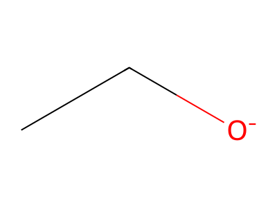|**ethanolate**, or **ethoxide**, or **ethyl oxide anion**|[View Molecule](https://fbeilstein.github.io/molecular_workbench/viewer.html?bundle=bundles/molecules/ethanolate.zip&download)|Charge: -1 <br>SMILES: CC[O-]|
|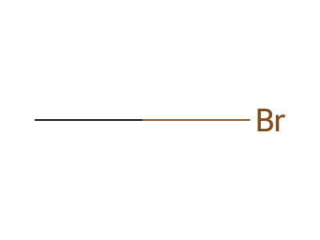|**bromomethane**, or **methyl bromide**, or **monobromomethane**, or **R-40B1**, or **freon 40B1**, or **halon 1001**|[View Molecule](https://fbeilstein.github.io/molecular_workbench/viewer.html?bundle=bundles/molecules/bromomethane.zip&download)|SMILES: CBr|


</details>
* [MOLECULAR VIEWER](https://fbeilstein.github.io/molecular_workbench/viewer.html)
