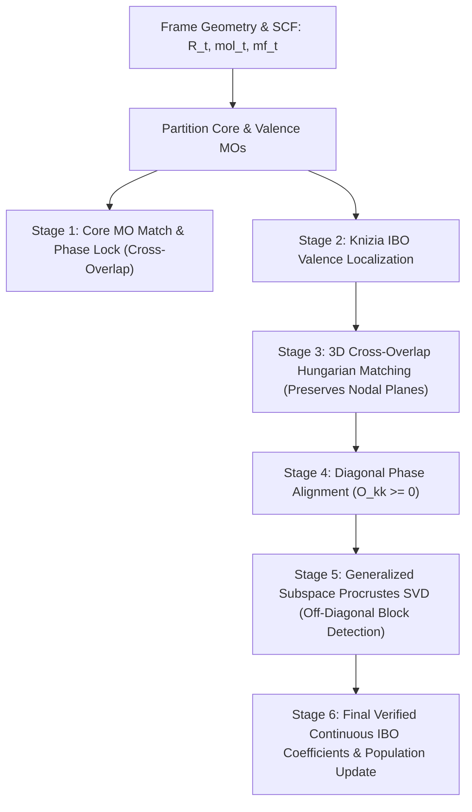

# Orbital Matching Across Reaction Coordinate Frames

## 1. Executive Summary

In quantum chemical reaction path analysis (such as Intrinsic Reaction Coordinate, IRC), tracking the reorganization of electronic structure requires following molecular orbitals across sequential geometries $t_0, t_1, \dots, t_N$.

Standard electronic structure calculations solve the Roothaan-Hall Self-Consistent Field (SCF) equations independently at each nuclear configuration:

$$F(\mathbf{R}_t) C_t = S(\mathbf{R}_t) C_t \varepsilon_t$$

Because each SCF calculation is solved in isolation without memory of preceding geometries, raw molecular orbitals suffer from three severe pathologies:
1. **Random Global Phase Sign Inversion**: A wavefunction $\psi_i(\mathbf{r})$ and $-\psi_i(\mathbf{r})$ produce the exact same electron density $\rho(\mathbf{r}) = |\psi_i(\mathbf{r})|^2$. Numerical diagonalization routines arbitrarily assign $\pm 1$ phase signs, causing visual 3D isosurfaces to blink and invert violently between frames.
2. **Eigenvalue Reordering (Orbital Scrambling)**: As bonds break and form, orbital energy eigenvalues cross each other. An orbital that was $\text{HOMO}-1$ at the reactant geometry can become $\text{HOMO}$ at the transition state.
3. **Loss of Spatial/Angular Information from 1D Scalar Reductions**: Reducing 3D wavefunctions to 1D atomic partial populations (Mulliken/IAO) strips away angular momentum and nodal symmetry. For instance, a $\sigma$-bond and a $\pi$-bond between the same two atoms (e.g., in a carbonyl $\text{C}=\text{O}$) yield nearly identical population vectors ($\approx 1.0$ on $\text{C}$, $\approx 1.0$ on $\text{O}$), making them appear degenerate to population-based assignment algorithms.
4. **Subspace Degeneracy & Localization Rotations**: Intrinsic Bonding Orbitals (IBO) localizers optimize a non-convex 4th-moment functional. In near-degenerate subspaces—such as oxygen lone pairs, rotating methyl $\text{C}-\text{H}$ bonds, or multiple bonds in a $\pi$-system—numerical solvers settle on arbitrary unitary rotations from frame to frame, appearing as sudden discontinuous jumps.

The **Reaction Orbital Engine** in `molecular_workbench` (`irc_plugins/ts_engine/orbital_ibo.py`, `orbital_frontier.py`, and `step_6_orbitals.py`) implements a stabilized, 3D cross-overlap matching and generalized Orthogonal Procrustes alignment pipeline.

---

## 2. Mathematical Foundation

### 2.1 Cross-Geometry Overlap Metric ($S^{\text{cross}}$)

At frame $A$ with nuclear geometry $\mathbf{R}_A$ and frame $B$ with geometry $\mathbf{R}_B$, the atomic orbital (AO) basis functions $\chi_\mu^A(\mathbf{r})$ and $\chi_\nu^B(\mathbf{r})$ are centered at different nuclear positions.

The cross-geometry AO overlap matrix $S^{\text{cross}} \in \mathbb{R}^{N_{\text{AO}}^A \times N_{\text{AO}}^B}$ is evaluated via:

$$S_{\mu\nu}^{\text{cross}} = \langle \chi_\mu^A \mid \chi_\nu^B \rangle = \int_{\mathbb{R}^3} \chi_\mu(\mathbf{r} - \mathbf{R}_{\mu}^A) \, \chi_\nu(\mathbf{r} - \mathbf{R}_{\nu}^B) \, d^3\mathbf{r}$$

In PySCF, this is computed using Gaussian integral engines via `gto.intor_cross("int1e_ovlp", mol_A, mol_B)`.

### 2.2 Molecular Orbital Overlap in the Cross Basis

Let $C_A \in \mathbb{R}^{N_{\text{AO}}^A \times N_{\text{MO}}}$ and $C_B \in \mathbb{R}^{N_{\text{AO}}^B \times N_{\text{MO}}}$ be the coefficient matrices expressing orbitals in terms of their respective AO bases:

$$\psi_i^A(\mathbf{r}) = \sum_\mu C_{\mu i}^A \chi_\mu^A(\mathbf{r}), \quad \psi_j^B(\mathbf{r}) = \sum_\nu C_{\nu j}^B \chi_\nu^B(\mathbf{r})$$

The matrix of scalar products between all orbitals at frame $A$ and frame $B$ is:

$$O_{ij} = \langle \psi_i^A \mid \psi_j^B \rangle = \left( C_i^A \right)^\top S^{\text{cross}} \, C_j^B$$

Or in full matrix notation:

$$O = C_A^\top S^{\text{cross}} C_B$$

Unlike 1D atomic populations, the cross-overlap matrix $O$ inherently preserves:
- Full 3D spatial orientation and shape
- Nodal plane symmetry ($\langle \sigma \mid \pi \rangle \equiv 0$ due to symmetry cancellation across the nodal plane)
- Wavefunction phase continuity

---

## 3. Stabilized 6-Stage Matching Pipeline



### Stage 1: Core-Valence Partitioning

Core electrons (e.g., 1s for Carbon, Nitrogen, Oxygen; 1s, 2s, 2p for Chlorine) remain chemically inert spectators across ordinary chemical reactions and have orbital energies $\varepsilon < -50\text{ eV}$.

1. Molecular orbitals are split into core ($C_{\text{core}}$) and valence ($C_{\text{val}}$):
   $$C = [C_{\text{core}} \mid C_{\text{val}}]$$
2. For frame $t > 0$, core orbitals are matched against frame $t-1$ using maximum absolute cross-overlap:
   $$M_{\text{core}} = C_{\text{core}}^{t-1\top} S^{\text{cross}} C_{\text{core}}^t$$
3. Linear Sum Assignment (Hungarian algorithm) solves:
   $$\max_\pi \sum_k |M_{k, \pi(k)}|$$
4. Phase alignment flips signs:
   $$\text{if } M_{k, \pi(k)} < 0 \implies C_{\text{core}, k}^t \leftarrow -C_{\text{core}, k}^t$$

### Stage 2: Intrinsic Bonding Orbital (IBO) Localization

Valence orbitals are localized using Knizia's Intrinsic Bonding Orbital (IBO) method:
- Computes Intrinsic Atomic Orbitals (IAO) via projection into a depolarized minimal basis.
- Maximizes the 4th-moment localization functional (equal to the sum of squared IAO charges):
  $$L(C) = \sum_{k} \sum_{A} \left( q_{k, A} \right)^4$$
- The resulting localized orbitals cleanly identify textbook Lewis structures ($\sigma$-bonds, $\pi$-bonds, and lone pairs $\text{LP}$).

### Stage 3: Valence Orbital Tracking via 3D Absolute Cross-Overlap

**Why scalar population matching was replaced**:
Previously, a cost function based on atomic population vectors $\mathcal{C}_{ij} = \sum_A (p_{i,A}^{t-1} - p_{j,A}^t)^2$ was evaluated. Because a $\sigma(\text{C}-\text{O})$ and a $\pi(\text{C}-\text{O})$ bond possess almost identical partial charge distributions ($\approx 1.0$ e on C and $\approx 1.0$ e on O), the population difference is near zero. The Hungarian solver frequently cross-paired $\sigma \leftrightarrow \pi$.

**The Stabilized Metric**:
The algorithm computes the full 3D cross-overlap matrix:

$$O_{\text{val}} = (C_{\text{val}}^{t-1})^\top S^{\text{cross}} C_{\text{val}}^t \in \mathbb{R}^{N_{\text{val}} \times N_{\text{val}}}$$

Because $\langle \sigma \mid \pi \rangle \approx 0$ by spatial symmetry, while $\langle \sigma \mid \sigma \rangle \approx 1$ and $\langle \pi \mid \pi \rangle \approx 1$, the cross-overlap matrix eliminates the $\sigma/\pi$ degeneracy.

SciPy's `linear_sum_assignment` finds the optimal 1-to-1 permutation matrix:

$$\pi^* = \arg\min_\pi \sum_i - \left| (O_{\text{val}})_{i, \pi(i)} \right|$$

Columns of $C_{\text{val}}^t$ are permuted according to $\pi^*$, ensuring orbital index $k$ corresponds to the exact same 3D spatial feature throughout the pathway.

### Stage 4: Diagonal Phase Locking

After matching, the diagonal phase of each valence orbital is evaluated:

$$s_k = (C_{\text{val}, k}^{t-1})^\top S^{\text{cross}} C_{\text{val}, k}^t$$

If $s_k < 0$:
$$C_{\text{val}, k}^t \leftarrow -C_{\text{val}, k}^t$$

This guarantees that all diagonal projections satisfy $O_{kk} > 0$ before subspace analysis.

### Stage 5: Generalized Subspace Procrustes SVD Alignment

**Why the single-atom population filter was replaced**:
Previously, subspaces were identified using `primary_atom[k] == A and val_pops[k, A] > 1.2`. This restricted the rotation fix strictly to single-atom lone pairs. It completely ignored shared covalent bonds ($p_{k,A} \approx 1.0 < 1.2$), leaving rotating methyl $\text{C}-\text{H}$ bonds or mixing covalent bonds susceptible to arbitrary IBO localizer rotations.

**Generalized Off-Diagonal Cross-Overlap Block Detection**:
Re-evaluating the aligned cross-overlap matrix:
$$O_{\text{val}} = (C_{\text{val}}^{t-1})^\top S^{\text{cross}} C_{\text{val}}^t$$

When orbitals mix or rotate across adjacent frames (whether lone pairs, methyl $\text{C}-\text{H}$ bonds, or rearranged covalent bonds), off-diagonal elements become non-negligible.

The engine constructs an adjacency graph over all valence orbitals $V = \{0, 1, \dots, N_{\text{val}}-1\}$:
$$\text{Edge}(i, j) \iff \max(|(O_{\text{val}})_{ij}|, |(O_{\text{val}})_{ji}|) > \theta \quad \text{AND} \quad |\varepsilon_i - \varepsilon_j| < \Delta \varepsilon_{\text{max}}$$
(with threshold $\theta = 0.20$ and degeneracy window $\Delta \varepsilon_{\text{max}} = 1.5\text{ eV}$).

**Why the Energy Degeneracy Constraint is Physically Mandatory**:
When molecules translate across frames during reaction approach (e.g., $0.27\text{ \AA}$/frame translation), the 3D atomic orbital basis sets shift in space. This creates an artificial, non-quantum cross-overlap between spatially proximate but energetically separated orbitals (e.g. an oxygen lone pair at $\varepsilon \approx -6\text{ eV}$ and a C-O $\sigma$-bond at $\varepsilon \approx -26\text{ eV}$).

Without the energy degeneracy guard, unconstrained SVD Procrustes treats this translation cross-overlap as an orbital mixing subspace, rotating the lone pair toward the $\sigma$-bond by $\approx 5^\circ$ each frame. Over 8 frames of approach, this rotational drift accumulates to $\sim 45^\circ$, causing a pure lone pair to falsely morph into a $\sigma$-bond halfway through the approach, before rotating back when the step geometry changes. Restricting Procrustes SVD to true degenerate manifolds ($|\Delta \varepsilon| < 1.5\text{ eV}$) completely prevents this unphysical rotational drift while still perfectly aligning rotating methyl $\text{C}-\text{H}$ bonds and degenerate lone pairs.

For each component $\mathcal{K}$:
1. Extract the subspace blocks:
   $$C_{\text{sub}}^{\text{prev}} = C_{\text{val}}^{t-1}[:, \mathcal{K}], \quad C_{\text{sub}}^{\text{curr}} = C_{\text{val}}^t[:, \mathcal{K}]$$
2. Form the subspace cross-overlap:
   $$M_{\text{sub}} = (C_{\text{sub}}^{\text{prev}})^\top S^{\text{cross}} C_{\text{sub}}^{\text{curr}} \in \mathbb{R}^{m \times m}$$
3. Perform Singular Value Decomposition (SVD):
   $$M_{\text{sub}} = V \Sigma W^\top$$
4. Compute the optimal Orthogonal Procrustes rotation matrix $U \in \mathrm{O}(m)$:
   $$U = W V^\top$$
5. Guard against unwanted reflections ($\det(U) < 0$):
   $$\text{if } \det(U) < 0 \implies W[:, -1] \leftarrow -W[:, -1], \quad U = W V^\top$$
6. Rotate current orbitals into optimal alignment with the previous frame:
   $$C_{\text{val}}^t[:, \mathcal{K}] \leftarrow C_{\text{sub}}^{\text{curr}} U$$

### Stage 6: Final Phase Verification & Population Update

1. A final phase check ensures positive diagonal projection for all orbitals:
   $$\text{if } (C_{\text{val}, k}^{t-1})^\top S^{\text{cross}} C_{\text{val}, k}^t < 0 \implies C_{\text{val}, k}^t \leftarrow -C_{\text{val}, k}^t$$
2. Atomic electron populations are recalculated from the final, continuously rotated vectors:
   $$p_{k, A} = 2 \times \sum_{\mu \in A} \left[ (v_k v_k^\top) S \right]_{\mu\mu}$$

---

## 4. Chained Sequential Discovery (`_ensure_frame_computed`)

Interactive exploration allows users to scrub backwards, jump to arbitrary frames, or precompute slices. To maintain the validity of frame-to-frame matching:

```python
def _ensure_frame_computed(self, frame_idx: int, megajson: Dict[str, Any]) -> Dict[str, Any]:
    with _CACHE_LOCK:
        if frame_idx in _SCF_CACHE:
            return _SCF_CACHE[frame_idx]
        if 0 not in _SCF_CACHE:
            self._compute_single_frame(0, None, megajson)
        if frame_idx == 0:
            return _SCF_CACHE[0]

        closest = min(_SCF_CACHE.keys(), key=lambda k: abs(k - frame_idx))
        if closest < frame_idx:
            for fi in range(closest + 1, frame_idx + 1):
                if fi not in _SCF_CACHE:
                    self._compute_single_frame(fi, _SCF_CACHE[fi - 1], megajson)
        elif closest > frame_idx:
            for fi in range(closest - 1, frame_idx - 1, -1):
                if fi not in _SCF_CACHE:
                    self._compute_single_frame(fi, _SCF_CACHE[fi + 1], megajson)
        return _SCF_CACHE[frame_idx]
```

- When frame $k$ is requested, the system finds the closest previously computed frame in cache.
- It marches step-by-step ($k-1 \to k$ or $k+1 \to k$), propagating orbital identities and phase orientations transitively.
- The entire reaction coordinate forms an unbroken, deterministic chain of continuity.

---

## 5. Summary of Enhancements

| Component | Legacy Implementation | Stabilized Implementation | Reason for Improvement |
| :--- | :--- | :--- | :--- |
| **Valence Cost Metric** | 1D Population Vector $\Delta p_A^2$ | 3D Absolute Cross-Overlap $\|C_{\text{prev}}^\top S^{\text{cross}} C_{\text{curr}}\|$ | Preserves 3D spatial orientation and nodal planes; eliminates $\sigma/\pi$ false degeneracies. |
| **Subspace Identification** | Heuristic single-atom threshold $p_A > 1.2$ | Off-diagonal cross-overlap block detection ($\|O_{ij}\| > 0.15$) | Captures mixing in shared covalent bonds ($\text{C}-\text{H}$, $\text{C}=\text{C}$, $\text{C}-\text{O}$) in addition to lone pairs. |
| **Rotation Guard** | Standard SVD | Proper rotation projection ($\det(U) > 0$) | Prevents parity/reflection inversions during unitary rotation. |
| **Order of Operations** | Population sort $\to$ Lone-pair SVD | Cross-overlap Hungarian $\to$ Generalized Block SVD $\to$ Phase Lock | Eliminates column-scrambling interference with the Procrustes objective. |
